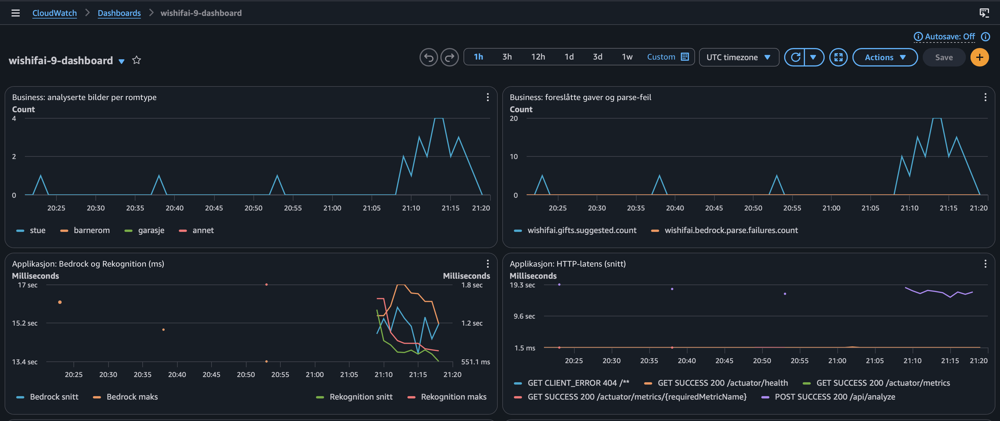
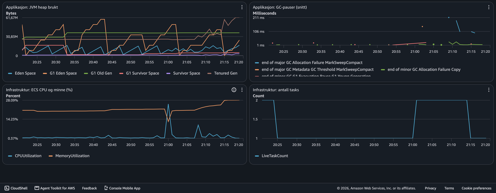
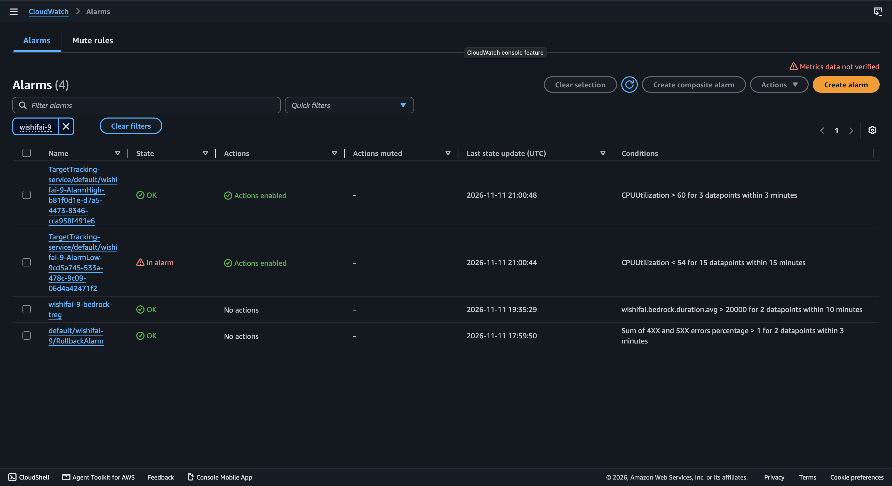

# PGR301 Eksamen 2026 – Wishifai

Kandidatnummer: 9
Repo: https://github.com/JJRBIP/pgr301-DevOps_i_skyen-eksamen-knr9

## Oppgave 1A – Dockerfile

Kjør lokalt:

    docker build -t wishifai .
    docker run -p 9999:8080 -e AWS_REGION=eu-west-1 \
      -e AWS_ACCESS_KEY_ID=... -e AWS_SECRET_ACCESS_KEY=... wishifai

Appen svarer på http://localhost:9999.

Jeg bruker en multi-stage Dockerfile med to steg. I det første steget bygges JAR-filen 
med Maven (maven:3.9-eclipse-temurin-21). I det andre kopieres bare den ferdige JAR-filen inn i et lite 
runtime-image (eclipse-temurin:21-jre). Dermed havner ikke Maven, kildekoden og byggeverktøyene i det endelige imaget, 
som blir mindre og får færre ting som kan ha sikkerhetshull. Jeg kopierer også pom.xml og laster ned avhengigheter før 
jeg kopierer src, slik at Docker kan gjenbruke cachen når bare koden endres.

Containeren kjører som en egen bruker (appuser) og ikke som root. Hvis noen utnytter en svakhet i appen, 
får angriperen da færre rettigheter i containeren, og det er vanskeligere å gjøre skade på verten. 
Det er også god praksis å gi en prosess kun de rettighetene den trenger.

Imaget kjøres lokalt med docker run -p 9999:8080, slik at appen er tilgjengelig på http://localhost:9999.

## Oppgave 1B – GitHub Actions og ECR

- ECR-repo: wishifai-9
- Grønn kjøring: https://github.com/JJRBIP/pgr301-DevOps_i_skyen-eksamen-knr9/actions/runs/42501678287
- Tagging: Jeg tagger imaget med commit-SHA `${{ github.sha }}` i tillegg til latest. SHA-taggen gjør at jeg alltid kan 
           se hvilken commit et image kommer fra, så hvis noe feiler i en kjørende container, kan jeg finne nøyaktig 
           hvilken kode som ligger i den. Hver commit får sin egen SHA, så taggen blir i praksis ikke overskrevet av 
           senere bygg. `latest` flytter seg for hver push og sier ingenting om hvilken versjon som kjører, 
           så den bruker jeg bare som en praktisk snarvei.

## Oppgave 2A – Terraform

All Terraform-kode ligger i `infra/` (`provider.tf`, `variables.tf`, `main.tf`, `outputs.tf`).

**Ressurser:**
- `aws_ecs_express_gateway_service` (`wishifai-9`): kjører imaget fra ECR på port 8080, med health check på `/actuator/health`.
- `aws_s3_bucket` (`wishifai-uploads-9`): lagrer opplastede bilder.
- `aws_iam_role` og `aws_iam_role_policy` (`wishifai-task-role-9`): task role med tilgang til S3, Rekognition, Bedrock og CloudWatch.

**Valg:**
- Region, kandidatnummer og image-tag er variabler.
- Jeg bruker de eksisterende rollene (execution og infrastructure) og lager bare task role selv.
- `S3_BUCKET` og `AWS_REGION` settes automatisk fra Terraform.

**Offentlig URL:** https://wi-9b78dad250744149b7a4e51a96cf8056.ecs.eu-west-1.on.aws

## Oppgave 2B – Backend

Terraform-state lagres i S3 i stedet for lokalt:
    - **Bucket:** `pgr301-terraform-state` (region `eu-west-1`)
    - **Key:** `wishifai/9/terraform.tfstate`

Nøkkelen inneholder kandidatnummeret, slik at hver kandidat får sin egen state-fil i den delte bucketen og ingen 
overskriver andres infrastruktur.

**Hvorfor remote state:** 
    - State-filen er Terraforms oversikt over hva som er opprettet. Hvis den bare ligger på min maskin, 
      kan ikke andre eller en GitHub Actions-pipeline se den, og Terraform ville forsøkt å opprette alt på nytt. 
      Med felles state kan flere jobbe mot samme infrastruktur, og pipelinen i 2C kan kjøre `apply` mot de 
      samme ressursene. Kandidatnummeret er hardkodet fordi backend-blokken ikke støtter variabler.

## Oppgave 2C – GitHub Actions-job for Terraform

Workflowen `.github/workflows/build.yml` har to jobs:
1. `build` bygger Docker-imaget og pusher det til ECR med både commit-SHA og `latest` som tagger.
2. `terraform` har `needs: build` og kjører bare på `main`. Den sjekker formatet (`terraform fmt -check`), 
    kjører `init`, `validate` og `apply -auto-approve` mot `infra/`, med `image_tag` satt til commit-SHA-en.

AWS-credentials hentes fra GitHub Secrets (`AWS_ACCESS_KEY_ID` og `AWS_SECRET_ACCESS_KEY`), 
og alt annet står som `env` i workflowen.

**Hvorfor Terraform kjører etter build:**
    - Terraform-jobben bruker commit-SHA-en som image-tag, og det imaget finnes først i ECR når `build`-jobben er ferdig. 
Hvis Terraform kjørte før eller parallelt, kunne ECS Express blitt bedt om å starte et image som ennå ikke var pushet, 
og deployen ville feilet eller startet en gammel versjon. Derfor har `terraform` `needs: build`. Det betyr også at hvis 
bygget feiler, kjører ikke Terraform i det hele tatt, og en ødelagt versjon rulles aldri ut.

**Grønn kjøring:**: https://github.com/JJRBIP/pgr301-DevOps_i_skyen-eksamen-knr9/actions/runs/42620820542

## Oppgave 3 – Observability

### 3A – Metrikker i applikasjonen

Jeg bruker Micrometer og det eksisterende CloudWatch-registeret, og metrikkene
publiseres i namespace `wishifai`. `MetricsConfig` returnerte et tomt namespace, noe som ga
feilen "Namespace is required" i loggen. Jeg rettet det til `wishifai`.

| Metrikk | Type | Hva den måler |
|---|---|---|
| `wishifai.rekognition.duration` | Timer | Tid for `detectLabels` mot Rekognition |
| `wishifai.bedrock.duration` | Timer | Tid for `converse` mot Bedrock |
| `wishifai.images.analyzed` (tag `roomType`) | Counter | Analyserte bilder per romtype |
| `wishifai.gifts.suggested` | Counter | Antall gaveforslag generert |
| `wishifai.bedrock.parse.failures` | Counter | Antall ganger Bedrock-svaret ikke kunne parses som JSON |

**Tidsmålingene.** Grunderen vil vite hvor tiden går. Et kall til `/api/analyze` laster
opp bildet til S3, kjører Rekognition og så Bedrock. Ved å time Rekognition og Bedrock hver
for seg ser jeg hvilket av de to eksterne kallene som er flaskehalsen.

**Business-metrikker.** Jeg valgte antall analyserte bilder per romtype (stue, barnerom,
garasje, annet), fordi det viser hva brukerne faktisk laster opp og dermed hvilke
kundegrupper tjenesten brukes av. Antall gaveforslag er selve produktet kundene får, og det
henger sammen med Bedrock-kostnaden, siden hvert kall koster penger. Romtypen bestemmes av en
enkel regel basert på labels fra Rekognition (for eksempel "Living Room" eller "Couch" gir
stue). Det er en forenkling og ikke en eksakt klassifisering.

**Parse-feil.** Bedrock-svar er ikke deterministiske, og modellen kan svare i et annet format
enn appen forventer. Telleren viser hvor ofte det skjer, noe brukeren ellers bare ville
opplevd som dårlige resultater uten at noe krasjer.

### 3B – Dashboard og alarm

Dashboardet `wishifai-9-dashboard` og alarmen `wishifai-9-bedrock-treg` er definert i
`infra/monitoring.tf`. Terraform-jobben i pipelinen oppretter dem.

Skjermbilder med reelle data (kjørt mot den deployede tjenesten):

**Dashboardet** har åtte grafer:
- Business: analyserte bilder per romtype, og gaveforslag sammen med parse-feil.
- Applikasjon: Bedrock- og Rekognition-tid, HTTP-latens per endepunkt, JVM heap og GC-pauser.
- Infrastruktur: ECS CPU og minne, og antall tasks (`LiveTaskCount`).

Bedrock og Rekognition ligger på hver sin akse i samme graf, fordi størrelsesordenen er så
ulik at Rekognition ellers ikke ville vært synlig. HTTP-, JVM- og GC-grafene bruker
`SEARCH`-uttrykk, siden disse metrikkene har mange dimensjoner.

**Hva målingene viser.** Bedrock-kallet tar rundt 13–17 sekunder, mens Rekognition tar rundt
0,6–1,8 sekunder. `POST /api/analyze` tar til sammen opptil rundt 19 sekunder, mens
de andre endepunktene (helse og actuator) svarer på noen få millisekunder. Nesten all
ventetiden ligger altså i Bedrock, og det er der en forbedring vil ha størst effekt. Antall
tasks gikk mellom 1 og 2 under testene. Jeg har ikke undersøkt autoskaleringen nærmere.

**Alarmen** varsler når gjennomsnittlig Bedrock-tid (`wishifai.bedrock.duration.avg`) er over
20 sekunder i to perioder på fem minutter. Jeg valgte Bedrock fordi det er det tregeste leddet
og det brukeren venter på. Terskelen ligger over dagens normale nivå (13–17 sekunder), slik
at alarmen bare går ved en reell forverring og ikke hele tiden. Manglende data regnes som OK,
så alarmen ikke varsler når ingen bruker tjenesten.

Begrensning: alarmen har ingen varslingskanal (som SNS), så den endrer bare status i CloudWatch.

De andre alarmene i konsollen (`TargetTracking-...` og `RollbackAlarm`) er laget av ECS
Express, ikke av min Terraform-kode. At `AlarmLow` står som "In alarm", betyr at CPU er lav
nok til at autoskaleringen kan skalere ned, og er normalt.

**Begrensninger.** Testtrafikken brukte ett og samme bilde, så all aktivitet havner i
kategorien `stue`. Business-metrikkene viser dermed bare én romtype i bildene.

## Oppgave 4 – Drøfting

(300–500 ord, skrevet av deg.)